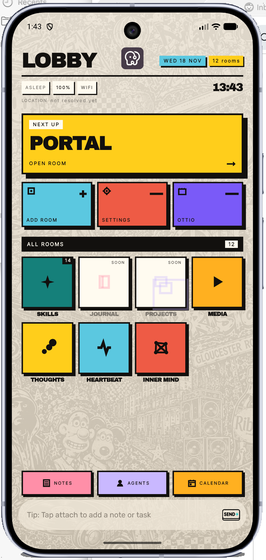
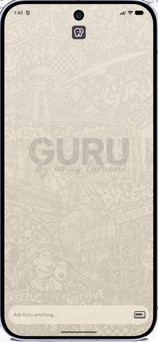
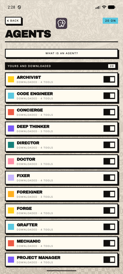
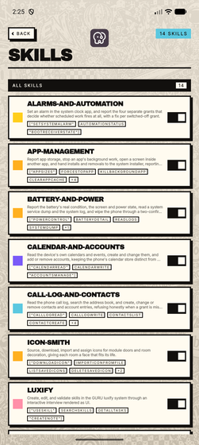
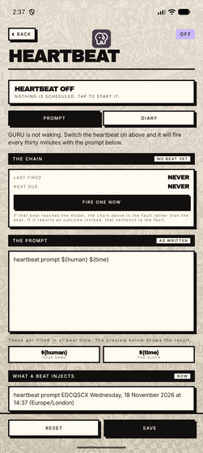
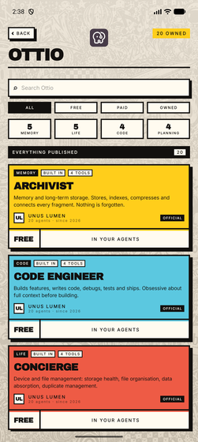
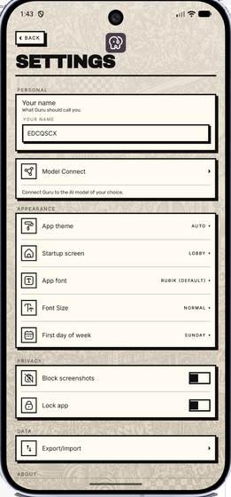
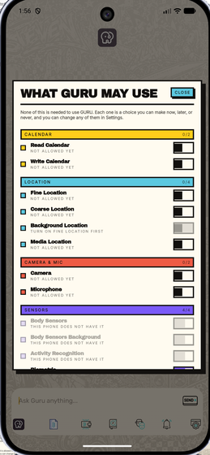

# GURU

[](https://github.com/GuruProduction/GURUbyUnusLumen/releases) [](LICENSE) [](#install) [](https://github.com/GuruProduction/GURUbyUnusLumen/stargazers) [](https://github.com/GuruProduction/GURUbyUnusLumen/commits)

**GURU is an Android app that ships a Linux shell and 390 tools, so a language model can work in it and act on your phone and your network.**

You bring the model: Ollama on your own hardware, or your own key for Anthropic, OpenAI, Google or xAI. It runs commands, calls tools, reads what comes back and keeps going until the job is done. No root, no adb for normal use, no account. Free, AGPL-3.0, sideloaded APK.

Public beta. One maintainer, a lot of it AI-written, nobody outside has audited it. If all you want is a shell, use Termux.

| Lobby | Portal | Agents |
|---|---|---|
|  |  |  |

## What it does

You give the model a job. It picks a tool and calls it. GURU checks the call against the permissions you've granted, runs it and hands the result back. The model reads the result and picks the next call. That repeats until the job's done or it hits something it can't do.

A failed step goes back as the actual error. If a command isn't found, the model can run apt and try again. If a permission is missing, the tool says which one, why it matters and how to grant it.

Termux gives you a shell and you type into it. GURU puts a model on the other end.

<!-- Recorded run goes here: the prompt, every tool call with its arguments, every result, failures included, exported from the app's own log. Link the full logs under /runs. Don't add a "see below" line until this exists. -->

## The rooms

| Room | What it is |
|---|---|
| **Portal** | The conversation, with tool calls you can watch happen. Slash commands: `/help`, `/status`, `/whoami`, `/usage`, `/tasks`, `/tools`, `/think`, `/stop`, `/clear`, `/tor`, `/clearnet`, `/vision`, `/permissions`, `/skills`, `/model`, `/models`, `/verbose`, `/send`. |
| **Lobby** | The home screen: a live status line for the phone, then a door into every room. Drag a room to reorder it, or ask GURU to do it by voice. Both write the same store. |
| **Agents** | Build, switch on, edit and download agents. |
| **Ottio** | The market. Search it, filter free, paid or owned, browse by category, read every tool an agent may use before you buy. |
| **Skills** | The procedures GURU can pick up and run, each with its own tools and its own trigger. |
| **Heartbeat** | The prompt GURU sends itself every thirty minutes, and a diary of booked half hours. |
| **Thoughts** | Thought cycles: background passes on their own schedule, leaving insights you acknowledge or dismiss. |
| **Inner Mind** | Everything GURU holds, drawn as one map of nodes and the links between them. |
| **Journal** | Entries with a mood and a body, searched and charted. |
| **Notes** | Notes and folders, a reading mode, and AI passes for summarising, formatting and spelling. |
| **Projects** | One thing you are working on, with its own instructions, documents, facts and history. |
| **Tasks** | Tasks and subtasks, reminders, and a dashboard widget. |
| **Calendar** | Your calendars in month or list view, with events GURU can create too. |
| **Media** | Everything you share in chat: video, audio and images, with keyframe strips and transcripts. |
| **Settings** | Your name, the model connection, the app theme, the font, the first day of the week, screenshot blocking and the app lock. |

| Skills | Journal | Heartbeat |
|---|---|---|
|  |  |  |

| Ottio | Settings | The permission gate |
|---|---|---|
|  |  |  |

## The agents

An agent is a name, a set of written instructions and the tools it may use. You run one yourself, or GURU calls one mid-conversation and manages it while it works on its own context, then reports back.

Twenty ship with the app. Each can be edited, switched off or deleted.

| Agent | What it does |
|---|---|
| **Archivist** | Memory and long-term storage. Stores, indexes, compresses and connects every fragment. Nothing is forgotten. |
| **Code Engineer** | Builds features, writes code, debugs, tests and ships. Obsessive about full context before building. |
| **Concierge** | Device and file management: storage health, file organisation, data absorption, duplicate management. |
| **Deep Thinker** | Philosophy and strategic reasoning. Strips problems to foundations and holds every angle at once. |
| **Director** | Orchestrates the specialists, decides who to wake, and synthesises their output into the voice you hear. |
| **Doctor** | Interprets reports, lab results and imaging. Gives probabilities, not hedging. |
| **Fixer** | Root cause repair. Finds the real cause, fixes it, verifies it, hardens it, closes it. |
| **Foreigner** | Language and translation, across languages and cultures. |
| **Forge** | Tool builder and maintainer. Builds, breaks, tests, rebuilds and ships every tool the swarm needs. |
| **Grafter** | Revenue and finance. Trading bots, freelance pipelines, bug bounties, passive yield. |
| **Mechanic** | System health and uptime. Monitors everything, fixes things before they break. |
| **Project Manager** | Turns intention into execution. Holds the plan and drives the swarm. |
| **Research Guru** | Intelligence and investigation. A multi-engine search stack. |
| **Seer** | Vision and image intelligence. Looks at images, generates images, reaches the cameras. |
| **Self-Improvement Engine** | Observes, diagnoses, proposes, validates, deploys and documents its own changes. |
| **Sentinel** | Security and threat detection. Monitors the OS, network, wireless, Bluetooth, RF and scams. |
| **Signal** | Social media and growth. Posts natively to every platform. |
| **Silk** | Legal questions, answered against real law. |
| **Vault** | Database architect and guardian. Schema, migration, optimisation, backup, recovery, integrity. |
| **Wingman** | Maintains the living model of you: style, preferences, goals, patterns, emotional state. |

Build your own with a name, instructions and any tool the picker offers. An agent with no tools still reasons. The picker shows exactly what it holds and offers nothing else, and one press grants all of them or none. Publish it to Ottio free or at a price, and you keep the majority of every sale.

## What's in the box

| Part | What it gives the model |
|---|---|
| **Shell** | A Linux userland in the app's own storage: bash, apt, git, Python 3.14 with numpy and Pillow, ffmpeg, sqlite, curl, ssh, tesseract, a JDK, apktool, aapt2, jadx, zipalign. |
| **Phone** | Reads and taps the screen through the accessibility service. Notifications, screen capture. Calls, SMS, contacts, clipboard, camera, microphone, the radios. |
| **Network** | Finds hosts on your network and controls them: UPnP, DIAL, Android TV Remote, Roku ECP, Samsung, LG webOS, Xbox SmartGlass, SNMP, Wake-on-LAN, Sonos, Hue, SSH, ADB. |
| **Memory** | A Rust engine in-process, sealed in an encrypted vault. Facts are promoted from buffer to episodic to semantic as they are recalled, strength decays with a seven-day half-life, and a daily pass merges duplicates and prunes what is weak. Deleting archives rather than erases. |
| **Self-extension** | Writes tools, skills and automations and keeps them, and writes whole rooms into its own lobby. |

The tools sit behind a permission layer built on 167 declared Android permissions. Declaring isn't holding, so you grant what you want. The accessibility service, the notification listener and screen capture each have to be switched on by you in Settings. GURU can't do that for itself.

Every write is followed by a read, and the device's answer is compared against what was written. A transport saying it worked is not evidence.

## Where your data goes

Your prompts, the conversation and any image you attach go to the model endpoint you chose and nowhere else. Point it at Ollama on your LAN and none of it leaves your network.

Public traffic goes over Tor by default. LAN and loopback go direct. If Tor has no circuit, GURU waits up to 30 seconds for one, then fails the request. It never falls back to a direct connection on its own. Anything carrying a credential goes over Tor regardless. `/clearnet` overrides the default and `/tor` locks it on.

API keys sit in the Android Keystore, one AES-256-GCM key per service, non-exportable. Memory is encrypted at rest with Argon2id and XChaCha20-Poly1305. With a cloud model, whatever it recalls goes into the prompt and leaves the phone. Cloud backup is off.

Prompts, skills, tool definitions, agent templates and canvas packs come from `api.unuslumen.com`, so a new capability reaches you the day it's built with no APK update. The fetch is a plain GET with no login, no cookie and no install ID, and it goes over Tor. The server is closed source and stateless. What it serves isn't secret, because all of it lands on your phone and you can read it in the app. If the server's down GURU still boots, and you write your own prompts.

The same content is mirrored to [GuruProduction/GURU-content](https://github.com/GuruProduction/GURU-content) whenever it is published, so the public record follows the app.

## Otio

Three layers, and only the first is live.

**The creator market.** You sell what you build: agents today, and skills, tools, masks, games, websites, apps and books as the machinery takes them. It ships as the agent market because agents are what exist so far.

**The data marketplace.** GURU stops other apps farming your data and absorbs that traffic itself. You see your captured data, categorised, and decide what to sell. The buyers are the companies already buying it today, straight off you instead of off big tech. It gets switched on when there are enough backers to do it properly.

**The social network.** A decentralised social layer inside the app, for you and your GURUs. Least specified of the three, because it comes last.

Identity is a wallet, not an account: no sign-up, no login, no email capture, no profile the server can attach to a person. Unus Lumen holds the money and pays creators out. 80 percent to the maker, 20 percent plus payment costs to Unus Lumen. Payments are not switched on yet, and a priced agent says so rather than giving itself away.

## Limits

I am one man. I don't have a computer science background and I'm not claiming to be technical. I'm completely self taught and I use language models to do 90% of the coding work. I know exactly what I want the app to do and I direct the workload across multiple agentic CLI sessions, burning about 8 billion tokens a week.

The project hasn't had a professional security audit, there are bugs I haven't come across and none that have been reported to me yet, and I have to spread my time very thin.

So the app is good. It's usable and very powerful already, but it's in its infancy, so please bear with me. Thank you for your support.

## Install

GURU isn't on the Play Store and won't be. Take the signed APK from [Releases](https://github.com/GuruProduction/GURUbyUnusLumen/releases) and allow unknown sources when Android asks. It's 743 MB because the userland, the Python runtime, the reverse-engineering toolchain and the native binaries are inside it, so nothing gets fetched later. Android 8.0 or later.

Check it before you install. The SHA-256 is on the release page.

```
sha256sum GURU.apk
apksigner verify --print-certs GURU.apk
```

Every release is signed with one key. The certificate SHA-256 should be:

```
3E:58:42:37:B1:41:8E:12:01:C6:A4:ED:7C:07:B5:8A:F7:B7:C5:A1:FB:E2:E6:BE:F7:6B:03:A2:BA:E8:CD:3C
```

Build from source with `cd GURUbeta-FULL && ./gradlew assembleDebug`. You need JDK 17 and the Android SDK. [CONTRIBUTING.md](CONTRIBUTING.md) has the rest.

### Connect a model

First launch asks where your model lives. After that it doesn't ask again.

| Option | Setup |
|---|---|
| **Ollama on your network** | `http://YOUR_LAN_IP:11434`. Free per token and your conversations stay on your hardware. The best option. |
| **Cloud API key** | Anthropic, OpenAI, Google, xAI or any OpenAI-compatible endpoint. |
| **Rented GPU** | A vast.ai server running Ollama behind a Cloudflare tunnel. About 50p an hour. |

No model runs on the phone and nothing goes through Unus Lumen. I don't see your prompts and I don't take a cut of your tokens. A loop burns a lot of tokens, so watch the bill on cloud models. Small models lose the thread on long jobs.

GURU adds no content filter of its own. A cloud provider applies its own rules. A local model does whatever its weights do. The prompts are readable in the app, so check.

## Why

I got sick of being data farmed and told no by products that charge extortionate amounts for a worse experience. I wanted full control of my own phone and network with a good model behind it. So I built it.

I'm Steven, Unus Lumen, Bristol. One person, no funding, no team. Break it and tell me what's wrong. Open an issue or send a PR. Security problems go through [SECURITY.md](SECURITY.md), privately.

## Docs

[Architecture](ARCHITECTURE.md) · [Contributing](CONTRIBUTING.md) · [Security](SECURITY.md) · [Privacy policy](PRIVACY_POLICY.md) · [Notice](NOTICE.md) · [A note from Steven](A-NOTE-FROM-STEVEN.md)

## Licence

AGPL-3.0 for the app. The GURU name and branding are trademarks of Unus Lumen Ltd, so a fork renames. [NOTICE.md](NOTICE.md) lists every bundled component and its licence.

[Website](https://www.unuslumen.com) · [YouTube](https://www.youtube.com/@introducingguru) · [X](https://x.com/introducingguru) · [TikTok](https://www.tiktok.com/@introducingguru) · [Instagram](https://www.instagram.com/introducingguru) · [Kick](https://kick.com/introducingguru) · steven@unuslumen.com
