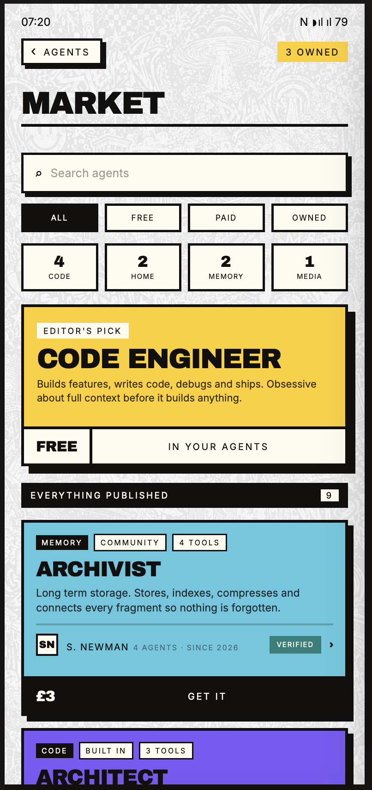
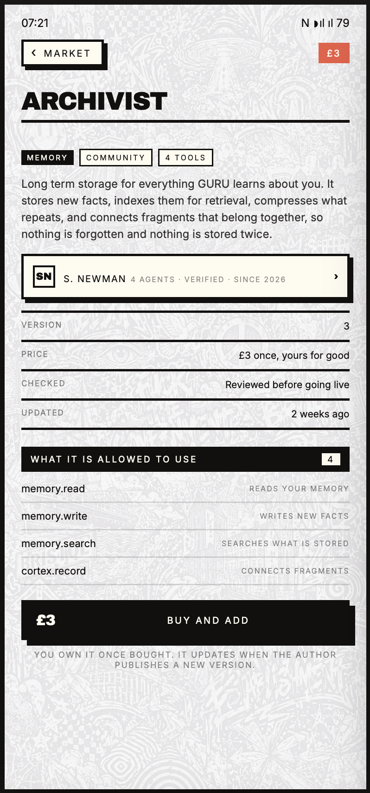
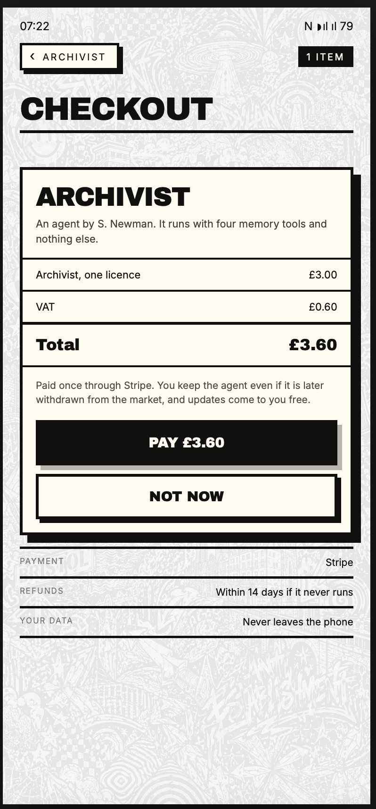
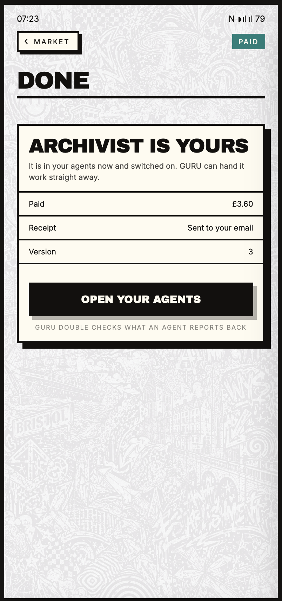
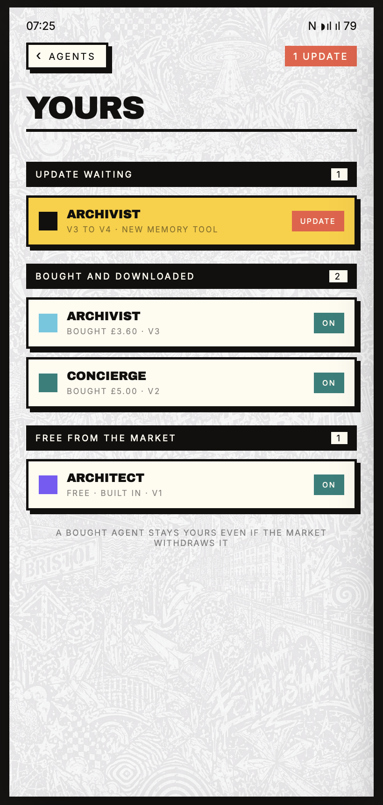
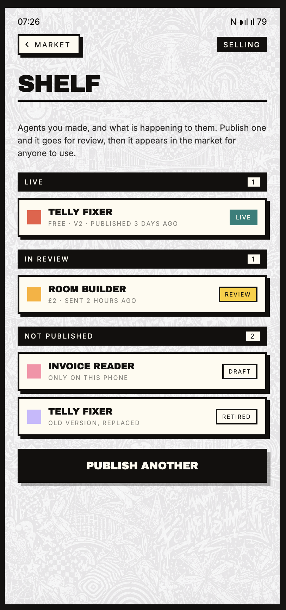
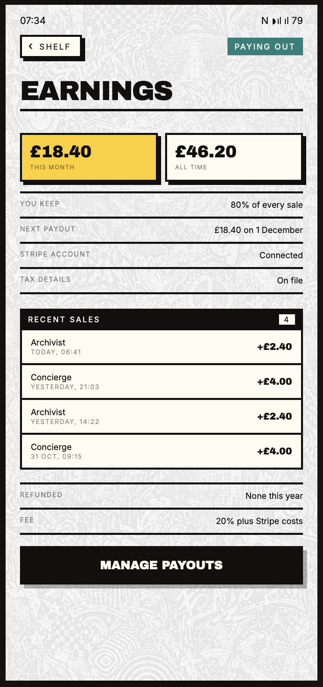
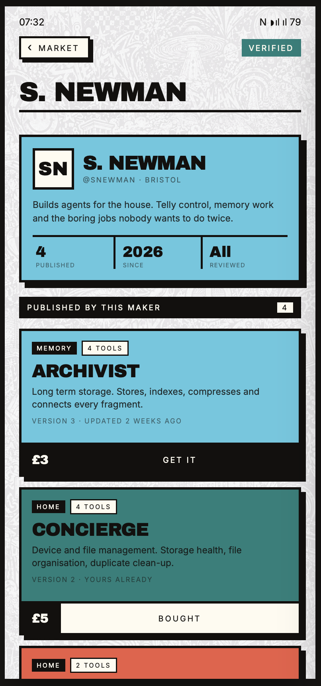
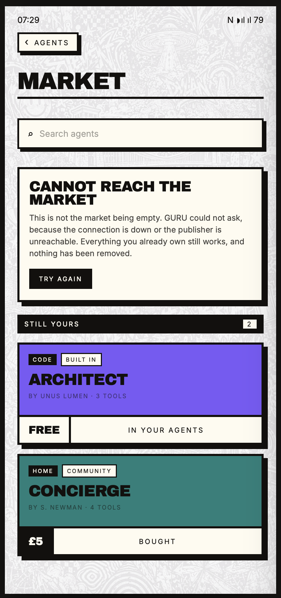
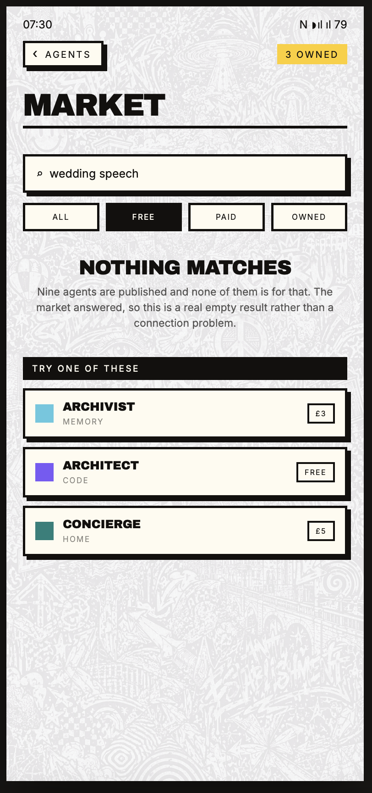

<div align="center">


# GURU by Unus Lumen

**An intelligence with hands. Your phone, your house, your network, your rules.**


</div>

---

DISCLAIMER: This is NOT another helpful assistant app! This is incredibly powerful technology that has never been publicly available in this form. Please read this repo carefully before downloading the release, [[here [current release]] 

GURU  reaches your phone, your television, your console, your lights, your speakers, your router and the machines in the cupboard, and it does the work. Not by describing what you could do. By doing it.

And it is not fixed. GURU writes its own tools, its own skills, its own automations and its own rooms. When it meets something it cannot do, it builds the capability and keeps it. That is the whole design: a super inteligence that gets more useful the longer you own it, rather than one that waits for me to ship an update.

Any model is powerful when you give it reach. GURU is the reach.

## What GURU actually is

It is not a chat app. it's a permission layer across 160+ Android permissions, a tool registry of around 390 tools and growing, an encrypted memory engine written in Rust, a full Unix userland bundled inside the APK, and a marketplace where people sell what they build.

You only ever open one app.

<details>
<summary><strong>External control: your whole house, from one phone</strong></summary>

GURU speaks the protocols devices actually use, rather than a list of brands I partnered with. UPnP and SOAP for boxes that expose services. DIAL for casting and app launch, including reading a device's app list and knowing the difference between a device that refused and one that never answered at all. Wake-on-LAN for anything asleep. Android TV Remote over its own protobuf protocol, so a Sony or a Philips or a Shield is drivable without an emitter. Roku's ECP. Samsung's websocket remote. LG webOS. Xbox SmartGlass all the way down, including the ECDH key exchange and the AES-CBC channel a console insists on before it will do anything. SNMP for hardware that will never have an app. IR through a Broadlink blaster or the phone's own emitter where one exists. SSH for any machine with a shell. ADB for anything running Android.

Televisions, Fire Sticks, consoles, lights, speakers, blinds, doors, sensors, the router, the printer, the thermostat. If it is on the network, GURU sees it, names it, and finds the way in. If it is not on the network, GURU learns the remote and blasts it instead.

Every capability is a protocol implemented properly, which is why coverage keeps widening instead of stopping at the brands somebody paid me to support.

**And it verifies.** Every write is followed by a read, and the value the device reports is compared against the value that was written. A transport saying it worked is not evidence. The device's own answer is. A command against a capability the device does not report is refused with a reason naming both, never quietly ignored — because a silent no and a success look identical to you, and one of them is a lie.
</details>

<details>
<summary><strong>Discovery that tells you the truth</strong></summary>

A network map is only worth having if it is honest, and most scanners are not. They hand you a list of IP addresses, miss anything that does not answer a broadcast, and call it a day.

GURU sweeps every port rather than a curated list, because a curated list is the bug. It reads mDNS and SSDP properly, with the multicast lock arranged rather than assumed. It fingerprints endpoints by their HTTP responses, their certificates, their DIAL description and their UPnP device document, so it can tell you what a thing *is* rather than that something answered. It walks the whole house, keeps the map, and notices what is new.

When it cannot reach something, it says so, and it tells a refusal apart from an absence. An empty list is never allowed to mean "I did not check".
</details>

<details>
<summary><strong>Memory that never forgets, in Rust</strong></summary>

The brain is a Rust engine running in-process, sealed in an encrypted vault with a passphrase generated on first run and never shown. There is no server in the path and no port open to the world.

Inside it is a real cognitive architecture rather than a vector table. Facts enter a BUFFER layer, get promoted to EPISODIC when they are recalled enough, and settle into SEMANTIC once they are strong and repeated. Strength decays exponentially with a seven-day half-life, recalling something strengthens it, a daily consolidation pass merges duplicates and prunes what is weak, and a graph records typed edges between memories — semantic, temporal, causal, and cross-references that mark two memories as contradicting, superseding or duplicating each other.

Nothing is really deleted. Deleting archives, because a memory trail you can rewrite is not a trail.

Every other assistant resets to zero every session and calls it a fresh start. That is a design choice, and it is why none of them ever actually know you. GURU remembers what you told it in March and uses it in November without being reminded.
</details>

<details>
<summary><strong>It builds its own capabilities</strong></summary>

I gave GURU the ability to extend itself, because a fixed assistant is a dead assistant.

It writes tools and registers them locally, and they are permanent. It writes skills and automations. It adds whole rooms to its own lobby, each one a vessel that starts empty and gets composed by talking to it. It can rewrite the prompt stack it runs on.

You should never be waiting on a company to decide your problem is worth solving. Describe the problem and let it build the thing.
</details>

<details>
<summary><strong>Its own Unix userland, already installed</strong></summary>

This is why GURU is not a wrapper around somebody else's capability.

The APK ships BusyBox, Toybox, a full Termux prefix with bash and apt, CPython 3.14 with numpy and Pillow, git with a working HTTPS transport, ffmpeg, sqlite, OpenSSL, OpenSSH, jq, rsync, tmux, Tesseract, and a reverse-engineering toolchain including a JDK, apktool, aapt2, jadx and zipalign.

No root. No setup. No tutorial. No "now go and install Termux". The tools are there because I put them there, and a pathshim makes prebuilt Linux binaries run on a stock Android phone. That same trick is what lets GURU drive a phone that would otherwise refuse it.
</details>

<details>
<summary><strong>Twelve rooms, not one screen</strong></summary>

The lobby is a page of tiles you drag into any order you like, and you can ask GURU to reorder them by voice. Make a new room by naming it; it appears immediately and you compose it by conversation.

**Portal** is the chat: streaming replies, tool calls you can watch happen, a canvas, attachments, and slash commands — `/help`, `/status`, `/whoami`, `/usage`, `/tasks`, `/tools`, `/think`, `/stop`, `/clear`.

**Agents** is where you make your own. Give one a name, instructions and the tools it may use, and it will take work off you in the background while your chat carries on. An agent with no tools still reasons; an agent with a tool can change something on your phone, and the picker tells you exactly which tools it has and nothing else is even offered to it. One press grants all of them or none.

**Ottio** is the market. **Inner Mind** is a living graph of everything GURU holds about you — memories, conversations, tasks, notes, projects, agents, skills, thoughts, people and every device it has found — drawn as one tissue you can explore rather than a list you scroll.

**Heartbeat** is the clock. **Skills** are imported capabilities. **Notes**, **Journal**, **Projects**, **Calendar** and **Thoughts** are the rooms you will live in, each one a full workspace with its own home-screen widgets, and **Settings** is where the brain and the model are configured.

**Media** ingests, probes, transcribes and indexes everything you throw at it, including OCR and keyframe extraction on video.

**Ad Space** is the one place I sell anything, and it is a canvas inside the app that runs animated packs the server pushes. It never interrupts your work.
</details>

<details>
<summary><strong>Lives on its own clock</strong></summary>

The heartbeat is the difference between an assistant and a presence.

It fires every thirty minutes into your newest conversation with a prompt you write yourself. Not a shipped default — yours, stored in the database, editable, with a live preview of exactly what a beat will inject, tokens and all.

The room shows you the chain's own pulse: when a beat last actually arrived, and when the next one is booked for. A booking proves only that an alarm was written. Firing proves one was delivered. Without both numbers, "scheduled and dead" and "scheduled and working" look identical.

The switch cannot be turned on without a prompt, because a chain with nothing to send is not a chain. Off always works, and nothing but you ever turns it off.

There is also a Fire Now button, and it hands the beat to the portal so you watch the reply stream in like any other turn. That exists because the first version fired headlessly into the database and the log proved it worked while the screen showed nothing, and a button that fires something you cannot see reads as broken.
</details>

<details>
<summary><strong>Everything through Tor, and it fails closed</strong></summary>

Every model call, every search, every request goes through an embedded Tor engine. Nobody sees what you ask.

When the circuit is not ready, the request throws rather than quietly going out over your own connection. That matters more than it sounds: the previous version returned an empty proxy list under a comment claiming it refused clearnet, and the HTTP stack reads an empty list as "no proxy", so "fail closed" was in fact a direct connection to the public internet. It throws now because throwing is what actually stops it.

Loopback and LAN addresses stay direct, so your own model keeps working with zero configuration. One policy, in one place, enforced in code rather than promised in a document.
</details>

<details>
<summary><strong>The instructions are yours to read</strong></summary>

Every prompt GURU runs on is pulled from the publisher, saved onto your phone in plain text and editable. There is no compiled-in instruction set and no hidden layer deciding what you are allowed to ask.

If you want to know why GURU did something, go and look. If you disagree with how it behaves, change it. There is no intellectual property I am protecting in those files, because you could do all of this yourself if you tried hard enough. I did it first, and you are welcome to it.
</details>

## Otio, the market

Otio is where GURU users publish agents and buy each other's work. It is a room of its own, not a sub-screen of the agents room, because a market is where you go to find what somebody else made and an agent is what you make for yourself.

Search it, filter by free, paid or owned, browse by category, look up the maker, read every tool the agent is allowed to use before you pay, buy it once, and keep it even if the author withdraws it later. Publishing is one line, a category and a price, and you keep the majority of every sale.

Every fact on the screen is served rather than invented. Counts come from real install and rating tables, makers come from real publisher records, prices come from the catalogue. Where the server has nothing to say the screen says nothing, so a rating nobody has given shows no stars at all instead of a fake zero. When the market cannot be reached it says so plainly and tells you everything you already own still works — because "could not ask" and "nothing exists" are different answers, and one of them is a lie about your phone.

**Payments are not switched on yet.** A priced agent will tell you so rather than quietly giving it to you for free and implying the price was never real.

Every image below was captured live on a phone.

<table>
<tr>
<td width="33%"><br><b>The market</b><br>Search, categories, editor's pick, and everything published.</td>
<td width="33%"><br><b>An agent's page</b><br>What it does, what it may use, who made it, and what it costs.</td>
<td width="33%"><br><b>Checkout</b><br>One price, VAT shown, paid once.</td>
</tr>
<tr>
<td width="33%"><br><b>Yours</b><br>Switched on and in your agents, ready for work straight away.</td>
<td width="33%"><br><b>Your agents</b><br>Updates waiting, things you bought, things you got free.</td>
<td width="33%"><br><b>Your shelf</b><br>What you have published, what is in review, what is retired.</td>
</tr>
<tr>
<td width="33%"><br><b>Publishing</b><br>One line, a category, a price. You keep the majority.</td>
<td width="33%"><br><b>Earnings</b><br>What sold, what you keep, and when you get paid.</td>
<td width="33%"><br><b>A maker's profile</b><br>Who built it, what else they made, and whether it was reviewed.</td>
</tr>
<tr>
<td width="33%"><br><b>Nothing hidden</b><br>When the market cannot be reached it says so, and everything you own still works.</td>
<td width="33%"><br><b>An honest empty</b><br>No results means no results, not a broken connection.</td>
<td width="33%"></td>
</tr>
</table>

## Bring your own model

GURU asks once, on first launch, where your model lives. Then it never asks again.

| Option | How | What it means |
|---|---|---|
| **Cloud API key** | Anthropic, OpenAI, Google, xAI, or any OpenAI-compatible endpoint | Your key stays on your device. Your conversations do not. |
| **Local model** | Point at Ollama on your network, `http://YOUR_LAN_IP:11434`, or any OpenAI-compatible server | Recommended. Zero token cost, and your conversations never leave hardware you own. |
| **Rented GPU** | Take a server on [vast.ai](https://cloud.vast.ai), pull a model with Ollama, put a Cloudflare tunnel on it | Cheap unlimited usage, still private through Tor, and about 50p an hour. |

No inference runs through any Unus Lumen dependency, ever. I do not take a cut of your tokens and I do not see your prompts.

Be honest with yourself about cost. An agentic framework burns tokens at agentic volumes, and flagship cloud models billed per token add up fast. A 120-billion-parameter open model on rented hardware beats most paid tiers outright, and the free tiers you are used to are small models that feel like a goldfish with amnesia. Ollama Cloud is close to a cheat code: massive multimodal models, serious agentic coders, a wide selection, and very little money.

## Free, and open source

GURU is free. AGPL-3.0, no accounts, no subscription, no premium tier, no token markup, no feature held back behind a plan. You connect a model and start talking to your numen. That is the whole setup.

**Honest state: this is a public beta.** The full source is here. On-device encryption and Tor routing have not yet had a professional security audit, though the security work is real and continuing. There are bugs, particularly in areas outside my own daily use. The people installing GURU right now are beta testers, and I would rather say that than dress it up. Install it knowing what it is, report what you find, and you are helping ship it.

The publisher is Unus Lumen's own infrastructure and stays closed source. It is deliberately stateless, holds no accounts and captures no conversations, so there is nothing there to leak. It feeds the app its prompts, skills, tool definitions, agent templates and canvas packs. A GURU that cannot reach a publisher still boots, but you will need to write and register your own prompts. Running publisher-less means operating your own compatible server or hand-installing the content, and the sync protocol is plain documented HTTP.

## Install

GURU is not on the Play Store and will not be. Take the signed APK from the [latest release](../../releases/latest) and allow installation from unknown sources when Android asks.

The APK is about 743 MB, and the size is the point. It carries the Python runtime, the Termux userland, the reverse-engineering toolchain and the native binaries, so none of it has to be fetched or assembled later. Android 8.0 or later.

Verify the SHA-256 on the release page before you sideload if that matters to you. It should.

You will need a model connected before GURU can do anything useful, and the onboarding walks you through it.

## Who is Unus Lumen

A tech company in Bristol, UK. Founded by Steven Newman. One person, unfunded, from a blank slate with no reference material. No team, no backers, nobody teaching me the rules.

I test the limits of what AI can do because the possibilities are endless and I refuse to be told no. Nobody taught me where the boundaries are supposed to be, so I never learned to build them in.

## What it becomes

GURU already works. It runs daily, it drives real hardware in my house, and it does things nothing else on a phone does. That is not a roadmap, that is this morning.

What it becomes is bigger. Every app on your phone becomes a dependency of GURU, and you only ever need to open one app. Your messages, email, calendar, smart home, searches, bookings, finance and creative work, all of it behind one intelligence that already knows the rest of your life.

Inside that ecosystem, people create. They build toolkits and skills and masks and agents and games, sell them on Otio, and sell their own data on their own terms. Unus Lumen takes a small cut of every transaction and keeps the lights on. The economy runs itself.

Masks will let you change the personality of your numen entirely. Serious and professional, funny and crude, dark and twisted, warm and gentle. Whoever you need it to be.

The vision is this. You get an idea in the shower. By the time you are dressed it is already in motion. Your numen has made the calls, built the thing and put it in place. Technology working for people instead of against them. Humans being human again, machines getting on with the work.

## Read more

| Document | What it covers |
|---|---|
| [Vision](VISION.md) | What GURU is for and why it exists |
| [Architecture](ARCHITECTURE.md) | The parts, the runtime paths and the invariants |
| [Contributing](CONTRIBUTING.md) | How to build, test, and get a pull request merged |
| [Security](SECURITY.md) | Vulnerability reporting and the attack surface |
| [Privacy Policy](PRIVACY_POLICY.md) | What leaves the device, and what does not |
| [NOTICE](NOTICE.md) | Every third-party component inside the APK, and its licence |
| [A note from Steven](A-NOTE-FROM-STEVEN.md) | Why I built this, in my own words |

## Build

```bash
cd GURUbeta-FULL && ./gradlew assembleDebug
```

JDK 17 and the Android SDK are required, and the Gradle wrapper lives inside `GURUbeta-FULL` rather than at the root. Full instructions, including the build lock and the three verification layers, are in [CONTRIBUTING.md](CONTRIBUTING.md).

## Licence

AGPL-3.0 for the app. The GURU name and branding are trademarks of Unus Lumen Ltd, Bristol, UK. A fork renames and does not imply endorsement. The licence governs the code and the trademark governs the name, and [NOTICE.md](NOTICE.md) has the full posture along with every bundled component's terms.

## The spirit

I was sick of being data farmed, lied to, and told no by products that charge extortionate amounts for a substandard experience. I wanted ultimate control of my own life, backed by superintelligence, with total privacy. So I built it.

Category defining tech should be community driven. Open source is the only road now. I have shown that this level of capability, control and privacy on an ordinary phone is possible. Now help me build it.

## Connect

- Website: **[www.unuslumen.com](https://www.unuslumen.com)**
- TikTok: [@introducingguru](https://www.tiktok.com/@introducingguru)
- Instagram: [@introducingguru](https://www.instagram.com/introducingguru)
- YouTube: [@introducingguru](https://www.youtube.com/@introducingguru)
- X: [@introducingguru](https://x.com/introducingguru)
- Kick: [kick.com/introducingguru](https://kick.com/introducingguru)

---

**GURU: built by Steven Newman** — Unus Lumen, Bristol, UK

steven@unuslumen.com
